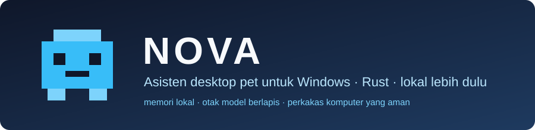
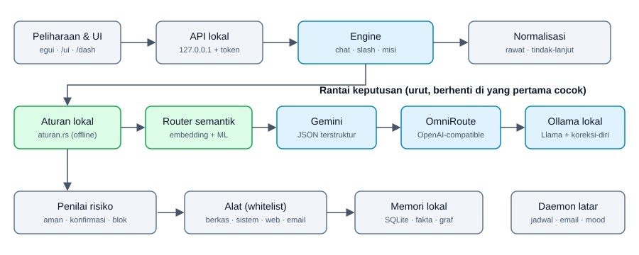

<p align="center"></p>

# NOVA

NOVA is a pixel-art pet that lives on my Windows desktop and can be talked to. I started it because I was tired of assistants that
live entirely in the cloud. I wanted one whose memory stays on my own laptop, that can tidy files and check the battery, and that
is still useful when the internet is down. It is written in Rust and I keep patching it.

Windows 10/11 only. The interface and most replies are in Indonesian.

## What it does

Most things work without any language model. Sentences that match a rule or are recognized by meaning (embeddings) run locally.
A model is only called when a sentence is not recognized: Gemini first, then OmniRoute, then a local Llama through Ollama. If the
local model returns broken JSON, the error is sent back to it once so it can correct itself.

Things I use every day:

- Find and tidy files. Changes are always previewed first and can be reverted with `urungkan` (undo).
- Check processes, battery, CPU, RAM and disk; set brightness and volume; open apps from an allow-list.
- Remember facts about me, my schedule and my habits, all in local SQLite. Follow-ups such as "only the ones released this year"
  continue the previous question.
- Weather, exchange rates, news by interest, prayer times, stock prices, and reading web pages through headless Chrome.
- Read email (Gmail, Outlook, IMAP) and send a summary to my own address, always after I approve it.
- Coding help: `/proyek`, `/log`, `/makro`, `/build`, git summaries, and an ad blocker (local DNS plus a browser extension).
- Usage statistics: day types, anomalies, disk forecast, and an estimate of when I start getting tired.

Type `/bantuan` in NOVA for the full command list.

## Try it

You need Windows and [Rust](https://rustup.rs).

```powershell
git clone https://github.com/afprayogi/nova-desktop-pet.git
cd nova-desktop-pet
cargo run --release
```

To install it permanently and start it at login (no admin rights), run `pasang-asisten.bat`. Remove it with `lepas-asisten.bat`.
Ctrl+Alt+N opens the quick chat.

Language models are optional. Add a Gemini key with `/gemini key <key>`; it is stored encrypted. For a local model, install
[Ollama](https://ollama.com) and use `/ollama` and `/lokal`; `llama3.2:1b` is enough on an 8 GB laptop. Email is set up with
`/google`, `/outlook`, `/email imap` and `/smtp`.

## How it works

<p align="center"></p>

The pet and the web UI are only clients of a local API on `127.0.0.1`, protected by a token. Every request goes to
`src/engine.rs`, which decides through the chain above. Before any tool runs, `alat::assess` rates it: safe, needs confirmation,
or blocked. The model only picks a tool name; Rust code with an allow-list does the actual work.

A quick map of `src/`: `engine/` (chat, `/` commands, mission planner), `aturan.rs` and `alat.rs` (language rules and tools),
`gemini.rs`, `omniroute.rs`, `lokal.rs` (model providers), `niat.rs` and `rawat.rs` (intent classification and sentence
normalization), `pet.rs` and `lukis.rs` (pet window and drawing).

## Development

```powershell
cargo test
cargo build --release
```

Close any running `nova.exe` before building a release, otherwise the file is locked.

## Privacy

Data lives in `%APPDATA%\nova`; delete that folder and everything is gone. What is recorded: the name of the active app and the
time, facts I save, chat history, and statistics. No global keystrokes, window titles or screen contents are stored, and OCR is
off by default. Keys, tokens and passwords are encrypted with Windows DPAPI. Model providers only receive the command text and a
short context, never file contents, the screen, or email.

## Characters

This repository ships no character artwork. Shimeji-style character packs go in `%APPDATA%\nova\karakter\<name>\`, or you can
build one from your own image with `/karakter buat <name> <image>`. Other people's artwork is for personal use only; do not
redistribute it.

## License

[MIT](LICENSE). Code adapted from other projects is credited in [NOTICE.md](NOTICE.md).
